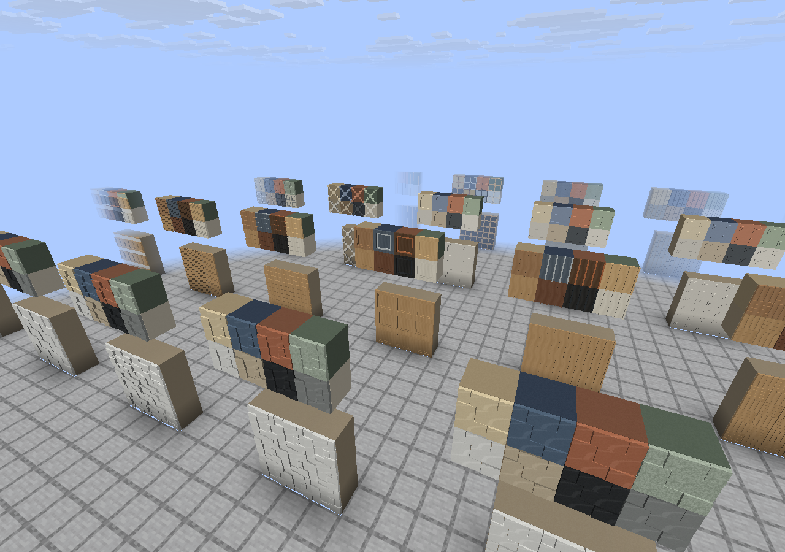

# Realistic Home Decor

Декоративный мод для **Minecraft Java Edition 1.21.11 / Fabric / Java 21**.

**Готовый мод:** [realistic-home-decor-0.2.0.jar](realistic-home-decor-0.2.0.jar).
Этот устанавливаемый JAR сохраняется в корне репозитория и включён в Git.

Версия **0.2.0**: **960 предметов — 120 конструкций × 8 согласованных палитр**.
Добавлены **40 самостоятельных рельефных стен**: кирпичная и каменная кладка,
деревянные панели, металл, бетон, штукатурка и акустические поверхности.
Мебель состоит из объёмных деталей: ножек, спинок, подушек, ручек, рам и фасадов.
Крупные конструкции занимают несколько настоящих блоков, каждая ячейка имеет
собственную модель и коллизию. [Полный каталог](docs/CATALOG.md).

Список новых стен: [WALLS.md](docs/WALLS.md). Цвета и материалы:
[PALETTES.md](docs/PALETTES.md). Все 320 идентификаторов предметов версии 0.1.0 сохранены.



## Что реализовано

- 11 вкладок: гостиная, кухня, ванная, спальня, кабинет, освещение, архитектура,
  строительные материалы, декор, сад и гараж.
- Четыре направления размещения, опоры на полу, стенах и потолке, проверка всего
  занимаемого объёма до установки многоблочной мебели.
- Соединяемые секции диванов, шкафы, панели и перила; совместимость определяется
  конструкцией, палитрой и направлением. При соединении меняются модель и коллизия.
- Очистка связанных частей после разрушения или потери опоры, проверка целостности
  при загрузке чанков. Постоянного тика мебели и Block Entity нет.
- Восемь палитр: дуб, орех, эбен, слоновая кость, шалфей, терракота, песок и сланец.
- Структурные стены со сплошной основой и настоящей геометрией лицевого рельефа;
  их можно ставить друг на друга и строить свободно, без опорного блока сзади.
  Для них применяется стандартная строительная коллизия 1×1×1 м; мебель
  сохраняет детальные формы столкновений.
- Статическое освещение ламп, прозрачное стекло, оригинальные общие материалы
  64×64, английские и русские названия, модели предметов для формата 1.21.11.
- Воспроизводимый параметрический генератор, проверка ресурсов, регрессионные
  тесты и отдельный инструмент создания нагрузочных сцен.

Шкафы, техника, сантехника и кровати служат украшением: у них нет инвентаря,
интерфейсов, анимаций или изменения точки возрождения. Двери статичны.

## Установка

Проверенная конфигурация:

| Компонент | Версия |
|---|---|
| Minecraft Java Edition | 1.21.11 |
| Java | 21 |
| Fabric Loader | 0.20.1 |
| Fabric API | 0.141.6+1.21.11 |

1. Установить Fabric Loader для Minecraft 1.21.11 через
   [официальный установщик](https://fabricmc.net/use/installer/).
2. Поместить Fabric API указанной версии и
   `realistic-home-decor-0.2.0.jar` в папку `mods` экземпляра Minecraft.
3. Запустить Fabric-профиль. Предметы доступны в творческом инвентаре; поиск
   работает по английским и русским названиям.

Для многопользовательской игры мод и Fabric API нужны как клиенту, так и серверу.
Файл `*-sources.jar` содержит исходники и не устанавливается в `mods`.

Готовый устанавливаемый мод сохраняется при каждой успешной сборке в корне:
**`realistic-home-decor-0.2.0.jar`**. Такая же копия и `SHA256SUMS` находятся в
`build/distributions/release/`. Это production JAR для обычного Fabric-профиля Minecraft;
Python, Gradle и тестовые моды игроку не нужны. Уберите предыдущий JAR этого
мода из `mods`, чтобы одновременно не загружались две его версии.

Подробная установка с другими модами и получение JAR из GitHub Actions:
[INSTALL.md](docs/INSTALL.md).

В текущем каталоге нет рецептов выживания. В творческом режиме можно брать мебель
из вкладок; для команд используется пространство имён `realistic_home_decor`, например:

```mcfunction
/give @s realistic_home_decor:modern_chair_oak
/give @s realistic_home_decor:modern_sofa_walnut
/give @s realistic_home_decor:wall_running_brick_terracotta
/give @s realistic_home_decor:wall_wood_coffered_sage
```

Ставьте предмет на подходящую поверхность, оставляя свободными все ячейки
большой конструкции. Направление выбирается при размещении. Для поворота уже
установленного предмета разрушьте его и поставьте снова. Настенная мебель
размещается на боковой грани опоры, потолочная — на её нижней грани.

## Сборка и разработка

Нужны полноценный **JDK 21** с `javac`, Python **3.10+** и доступ к официальным
репозиториям зависимостей. Системный Gradle устанавливать не требуется.

```bash
./gradlew --no-daemon build
```

В Windows используйте `gradlew.bat`. Сборка выполняет генерацию ресурсов,
их валидацию, Python-тесты, проверку Java-геометрии, компиляцию общей и клиентской
частей и создание production JAR. Результаты:
`realistic-home-decor-0.2.0.jar` в корне, `build/libs/realistic-home-decor-0.2.0.jar`
и устанавливаемая копия с контрольной суммой в `build/distributions/release/`.
Отдельно повторить упаковку можно
командой `./gradlew packageRelease` — она также выполняет проверки.

Используются проверенные **Gradle 9.2.1 / Fabric Loom 1.14.10 / официальные
Mojang mappings**. SHA-256 дистрибутива Gradle закреплён в wrapper-конфигурации.
Loom и Python нужны при разработке; игроку достаточно мода и Fabric API.

```bash
./gradlew runClient              # клиент разработчика
./gradlew runServer              # выделенный сервер в run/server
./gradlew runMetricsClient       # отдельный клиент для диагностических FPS/heap-логов
python3 -m unittest discover -s tests -v
python3 tools/validate_resources.py
```

Для серверного запуска сначала прочитайте Minecraft EULA; принимайте её только
при согласии. Сохранения и журналы разработчика находятся в игнорируемой папке `run/`.

Среда с HTTP-прокси требует настройки JVM-прокси и доверенного CA: Java не
переносит `HTTPS_PROXY` автоматически в системные свойства JVM. Используйте
поддерживаемые настройки среды, сохраняя проверку TLS. Подробнее о точных
подтверждённых зависимостях: [DEPENDENCIES.md](docs/DEPENDENCIES.md).

## Генератор мебели

```bash
python3 tools/furniture_generator/generate.py
python3 tools/furniture_generator/generate.py --check
```

Изменяйте шаблоны и палитры в `tools/furniture_generator/`, затем запускайте
генерацию. Генератор создаёт каталог регистрации, модели, blockstates, определения
предметов, текстуры, таблицы выпадения, переводы и документацию каталога. Геометрия
переиспользуется через родительские модели; код Java общий для всех конструкций.

Поддерживаются размеры, высота, толщина столешницы, тип опор, секции шкафов,
форма спинок и подлокотников, обивка и материалы. Подробный пример добавления
предмета приведён в [инструкции генератора](tools/furniture_generator/README.md).

Генератор защищает ручные изменения SHA-256-манифестом: он остановится, если
сгенерированный файл изменён вручную. `--check` ничего не записывает; `--force`
перезаписывает изменения только по явному запросу разработчика. Этапы
`--stage first-five`, `--stage first-twenty` и `--stage full` позволяют отдельно
собирать первоначальные наборы:

```bash
python3 tools/furniture_generator/generate.py --stage first-five
./gradlew build -x generateResources
```

Обычная сборка снова генерирует полный каталог. Для возврата к нему выполните
`python3 tools/furniture_generator/generate.py`, затем `./gradlew build`.

## Проверки и ограничения

Результаты версии 0.2.0 находятся в [VALIDATION_0.2.0.md](docs/VALIDATION_0.2.0.md),
исторические результаты 0.1.0 — в [VALIDATION.md](docs/VALIDATION.md),
протокол игровых проверок — в [TESTING.md](docs/TESTING.md).

```bash
python3 tools/scene_generator.py
python3 tools/scene_generator.py --check
```

Генератор сцен создаёт отдельный datapack для 100, 500 и 1000 целых предметов,
не изменяя существующие миры. Функции предназначены для отдельного тестового мира:
они заменяют блоки в явно указанной области. Методика измерений и пустая форма
результатов: [PERFORMANCE.md](docs/PERFORMANCE.md).

Известные ограничения:

- Декоративный каталог рассчитан на творчество; рецепты выживания не добавлены.
- Поворот производится по четырём направлениям; произвольного поворота и
  размещения деталей на долях блока нет. Малые аксессуары занимают отдельные ячейки.
- Коллизия сохраняет основные формы, но намеренно упрощает мелкую фурнитуру.
- Стеклянные конструкции используют стандартный прозрачный слой Minecraft;
  возможны обычные для него ограничения сортировки прозрачных поверхностей.
- Совместимость с шейдерами и сторонними модами требует отдельных испытаний.
  Из результатов сборки нельзя делать выводы об FPS на игровом компьютере.

При расширении палитр керамика и бетон согласованы с выбранными цветами; поэтому
некоторые старые предметы с сохранёнными ID получили новые оттенки. Первоначальные
PNG и материалы дерева, ткани, камня, металла и акцентов старых четырёх палитр
сохранены. Подробности изменений материалов приведены в [PALETTES.md](docs/PALETTES.md).

Мод не заменяет текстуры Minecraft и не меняет генерацию мира. Геометрия и
текстуры созданы для этого проекта. Лицензии сторонних инструментов и библиотек
сохраняются; лицензию распространения самого проекта владелец может выбрать
перед публикацией. Это не официальный продукт Mojang или Microsoft.
